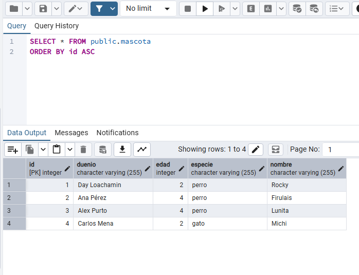
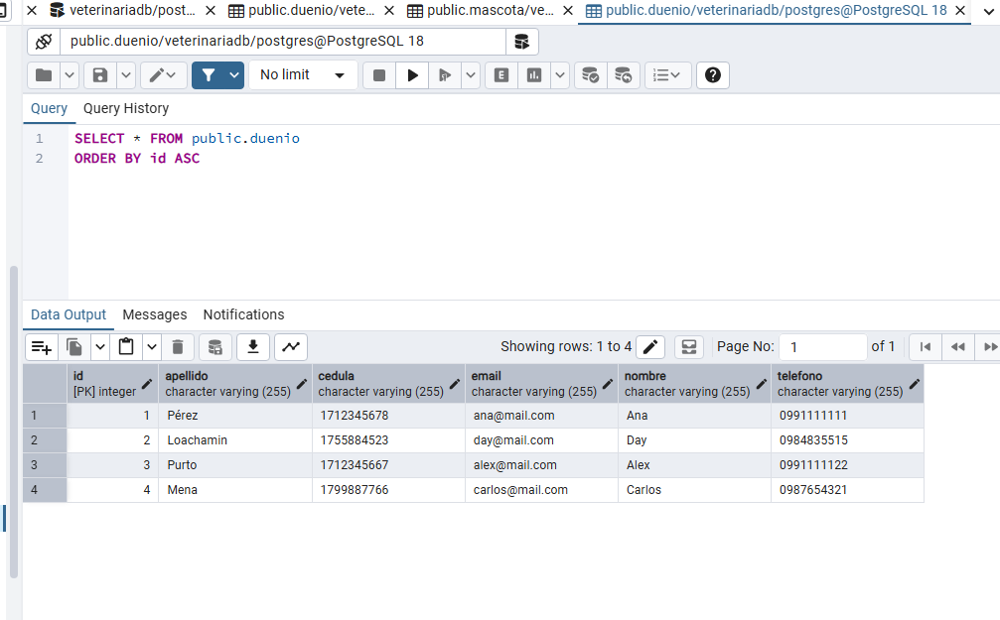
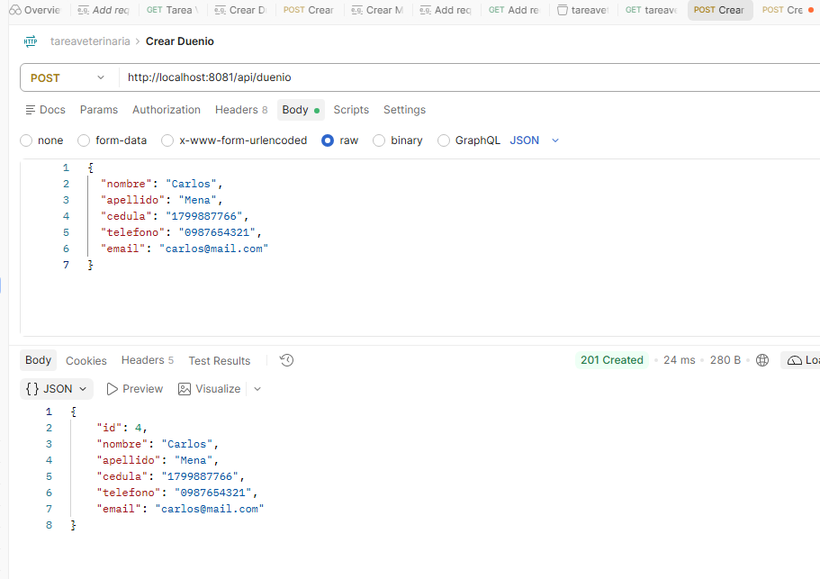

# API Clínica Veterinaria

Proyecto Spring Boot conectado a PostgreSQL para la gestión de Mascotas y Dueños.

## Opción elegida
Opción 3 (adaptada): Gestión de Mascotas y Dueños.

## Cómo ejecutar el proyecto
1. Ejecutar el script `database/script.sql` en PostgreSQL.
2. Configurar el archivo `application.properties` con las credenciales de la base de datos.
3. Ejecutar la clase `VeterinariaApplication` desde IntelliJ.
4. El servidor correrá en `http://localhost:8081`.

## Tabla de Endpoints

| Modelo | Método | Ruta | Códigos |
|---|---|---|---|
| Mascota | GET | `/api/mascota` | 200 |
| Mascota | GET | `/api/mascota/{id}` | 200, 404 |
| Mascota | POST | `/api/mascota` | 201 |
| Mascota | PUT | `/api/mascota/{id}` | 200, 404 |
| Mascota | DELETE | `/api/mascota/{id}` | 204, 404 |
| Mascota | GET | `/api/mascota/especie/{especie}` | 200 |
| Mascota | GET | `/api/mascota/conteo-especies` | 200 |
| Dueño | GET | `/api/duenio` | 200 |
| Dueño | GET | `/api/duenio/{id}` | 200, 404 |
| Dueño | POST | `/api/duenio` | 201, 409 (si cédula repetida) |
| Dueño | PUT | `/api/duenio/{id}` | 200, 404 |
| Dueño | DELETE | `/api/duenio/{id}` | 204, 404 |
| Dueño | GET | `/api/duenio/cedula/{cedula}` | 200, 404 |
| Dueño | GET | `/api/duenio/apellido/{apellido}` | 200 |

## Capturas

mascota

duenio

crear duenio 
